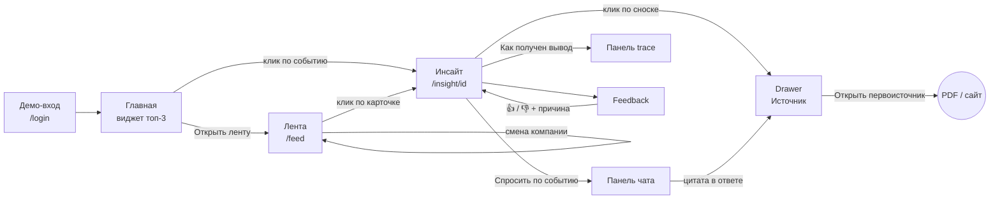

# Альфа-Инсайт · продуктовая рамка

> Issue: #7 · Owner: `mrsstrl` · Статус: v0, 21.10.2026
> Источник требований: кейс, [`.context/product.md`](../.context/product.md), [`.context/api.md`](../.context/api.md).
> Макеты и токены: [`design/`](../design/). Компании и люди ниже вымышлены, все цифры синтетические.

## 1. Рамка в одном экране

**Проблема.** Руководитель крупной компании каждое утро получает сотни новостей. Он не понимает, какие из них двигают *его* деньги. Аналитику банка читать некогда. Ответам чат-ботов он не доверяет: непонятно, откуда в них цифры.

**Ценностное предложение.**
Для руководителей компаний с выручкой больше 15 млрд ₽ Альфа-Инсайт внутри Альфа-Бизнеса за 5 минут показывает 3–5 событий, которые влияют на их компанию. Для каждого события сервис объясняет последствия в рублях и сроках и прямо помечает, что здесь факт, что позиция Альфа-Банка, а что вывод AI.
От новостных агрегаторов и чат-ботов сервис отличается тем, что каждый вывод привязан к профилю компании, её связям и проверяемому источнику.

**Чем продукт не является:** новостной лентой, пересказом новости одним вызовом LLM, инструментом проведения операций (tools только читают данные).

**Метрика ценности для демо:** за одну сессию пользователь понял одно событие, проверил источник и задал уточняющий вопрос. На это уходит не больше 5 минут.

## 2. Шесть вопросов интерпретации → шесть блоков карточки

Карточка инсайта отвечает ровно на шесть вопросов кейса. Седьмого блока нет: уверенность и ограничения живут внутри блоков 3 и 6.

| # | Вопрос кейса | Блок в UI | Поля `insight.schema.json` | Метка по умолчанию |
|---|---|---|---|---|
| 1 | Что произошло? | **Что произошло** | `what_happened.facts / participants / dates` | `fact` |
| 2 | Почему это важно для этой компании? | **Почему это важно для вас** | `why_relevant.company_features` (`fact` / `estimate`), `why_relevant.links` (`AI`) | `fact` + `AI` |
| 3 | Какие последствия возможны? | **Последствия** | `impact.risks / opportunities`, `horizon`, `confidence` | `AI`; числа — `estimate` |
| 4 | Какие действия релевантны? | **Что можно сделать** | `actions[].text / priority` | `AI` |
| 5 | Как это оценивает банк? | **Позиция Альфа-Банка** | `bank_view.quote / document / page` | `bank` |
| 6 | На чём основан вывод? | **На чём основан вывод** | `sources`, `trace`, `limitations`, `confidence` | — (источники) |

### Правила меток происхождения

| Метка | Когда ставим | Пример | Как выглядит |
|---|---|---|---|
| **Факт** (`fact`) | Утверждение подтверждено источником: новостью, документом или профилем клиента | «Банк России повысил ключевую ставку до 18%» | Сине-серый бейдж, иконка документа с галочкой |
| **Позиция Альфа-Банка** (`bank`) | Дословная цитата из аналитики банка с документом и страницей | «Ожидаем сохранения ставки на повышенном уровне…» · Макрообзор, стр. 7 | Красный бейдж, иконка кавычек, цитата с акцентной полосой |
| **Вывод AI** (`AI`) | Интерпретация агента на основе фактов; всегда со ссылкой на evidence | «Рост ставки увеличит процентные расходы» | Фиолетовый бейдж, иконка sparkle |
| **Оценка** (`estimate`) | Расчёт или прокси с допущениями: суммы, доли, percentile | «≈ +92 млн ₽ в год» | Янтарный бейдж с пунктирной рамкой, иконка «≈»; допущение — в подсказке |

Инварианты:
1. Вывод AI без `evidence_ids` не показываем.
2. «Позицию банка» не пересказываем: только verbatim-цитата со страницей.
3. Если позиция банка расходится с выводом AI, показываем обе и ставим метку «Расхождение».
4. Цвет никогда не единственный сигнал: у бейджа всегда есть текст и иконка.

## 3. Персоны

Одна компания может иметь нескольких пользователей с разными ролями. Каждая персона ниже привязана к одному из трёх демо-клиентов (см. `.context/demo.md`), поэтому три демо-сценария показывают три разные роли. Финальные названия компаний и цифры придут из seed (#31). Здесь — плейсхолдеры.

### P1 · Анна Ковалёва — финансовый директор (CFO)

| | |
|---|---|
| Компания | «Восток-Металл» (демо): металлургический экспортёр, выручка ≈ 128 млрд ₽, 58% выручки — экспорт, 4 компании в группе |
| Продукты банка | Кредиты 9,2 млрд ₽ с плавающей ставкой (КС + 2,5 п.п.), валютный контроль, ВЭД, зарплатный проект |
| Когда пользуется | Каждое утро 08:30–09:00, до планёрки в 10:00; ноутбук, иногда телефон |
| JTBD | Когда утром открываю банк, хочу за 5 минут понять, какие внешние события двигают процентные расходы, валютную выручку и ковенанты. Тогда до планёрки я решу, что поднять с казначейством и банком |
| Триггеры | Решение по ключевой ставке, курс USD/CNY, экспортные пошлины и квоты, санкции, цены на сталь и сырьё |
| Боли сейчас | Новости без привязки к цифрам компании; аналитика банка — длинные PDF; ответам AI нельзя доверять без источника |
| Критерии ценности | Влияние в рублях и сроках; позиция банка рядом с выводом; можно проверить любую цифру |
| Демо-сценарий | Ключевая ставка → долговая нагрузка: риск, действие, цитата банка (демо 1) |

### P2 · Дмитрий Орлов — руководитель казначейства

| | |
|---|---|
| Компания | «Город-Маркет» (демо): ритейлер-импортёр, выручка ≈ 46 млрд ₽, 380 магазинов, 35% ассортимента — импорт |
| Продукты банка | Платежи в CNY, валютный контроль, ВЭД, эквайринг, факторинг поставщиков |
| Когда пользуется | Несколько раз в день, перед платёжными окнами; ноутбук |
| JTBD | Когда меняется курс или ломается логистика, хочу заранее увидеть влияние на платежи поставщикам и ликвидность. Тогда я успею перенести платежи или захеджироваться |
| Триггеры | Курс CNY/RUB, ограничения на платежи и банки-корреспонденты, сбои в портах и на ж/д, проблемы у ключевых поставщиков |
| Боли сейчас | Узнаёт о сбое от поставщика, когда уже поздно; нет сценарных расчётов «что если» |
| Критерии ценности | Скорость сигнала; сценарий в цифрах; понятно, каких контрагентов это касается |
| Демо-сценарий | Курс и логистика → цепочка поставок; чат «что с маржой при курсе +10%» (демо 2) |

### P3 · Сергей Белов — собственник, председатель совета директоров

| | |
|---|---|
| Компания | ГК «Опора-Строй» (демо): девелопер, 6 юрлиц в группе, выручка ≈ 31 млрд ₽ |
| Продукты банка | Банковские гарантии 4,8 млрд ₽, факторинг, проектное финансирование, эскроу |
| Когда пользуется | 2–3 раза в неделю, вечером; планшет или телефон, коротко |
| JTBD | Когда что-то происходит с контрагентом или в регулировании отрасли, хочу понять косвенный риск для всей группы. Тогда я задам менеджменту правильные вопросы и приму стратегическое решение |
| Триггеры | Суды и банкротства контрагентов, проектное финансирование, ставка, льготная ипотека, госзаказ |
| Боли сейчас | Не видит связей «контрагент контрагента»; детали ему не нужны, нужны вывод и уверенность |
| Критерии ценности | Короткий вывод сверху; путь связи через граф; честная уверенность |
| Демо-сценарий | Новость о контрагенте → косвенный риск через граф (демо 3) |

## 4. CJM «Утро CFO»

Персона P1, вторник, 08:30–09:00. Цель — прийти на планёрку в 10:00 с позицией по вчерашнему решению ЦБ.

| Этап | Действие | Мысль | Эмоция | Экран | Боль сейчас → как помогаем | Метрика |
|---|---|---|---|---|---|---|
| 1. Вход · 08:30 | Открывает Альфа-Бизнес, на главной видит карточку «Что влияет на ваш бизнес сегодня» | «Есть ли что-то, о чём меня спросит генеральный?» | ↘ тревога | Главная, виджет | Нужно открыть 5 сайтов → 3 главных события прямо на главной | CTR виджета |
| 2. Скан · 08:33 | Смотрит ленту: риски, возможности, «почему в ленте» | «Ставка — понятно, а при чём тут пошлины?» | → интерес | `/feed` | Шум и дубли → ранжирование по профилю и объяснение отбора | Доля кликов в топ-3 |
| 3. Разбор · 08:36 | Открывает инсайт о ставке, читает 6 блоков | «+92 млн в год — это существенно. Что думает банк?» | ↗ понимание | `/insight/[id]` | Нет связи с цифрами компании → оценка в рублях и горизонт | Время до блока 5 |
| 4. Уточнение · 08:42 | Спрашивает в чате: «А если ставка дойдёт до 20%?» | «Нужна вилка для планёрки» | ↗ контроль | Панель чата | Нет сценариев → ответ с расчётом и цитатами | Доля сессий с вопросом |
| 5. Проверка · 08:47 | Открывает источник и trace, сверяет цитату банка со страницей PDF | «Можно ли это показать совету?» | → доверие | Источник, trace | AI-галлюцинации → дословная цитата и шаги агента | Доля открытий источника |
| 6. Действие · 08:52 | Ставит 👍, записывает вопросы к банку из блока 4 | «Обсудим своп с менеджером» | ↗ уверенность | Feedback | Действия неочевидны → вопросы и направления действий | Доля 👍, причины 👎 |

Моменты риска для доверия: шаг 3 (если цифры не объяснены) и шаг 5 (если цитата не совпадает с PDF). Именно там в макетах самые явные метки происхождения.

## 5. Информационная архитектура

```text
Альфа-Бизнес (shell: header + sidebar)
├─ Header
│  ├─ Переключатель компании (компании группы / демо-клиенты)
│  ├─ Профиль пользователя: имя, роль
│  └─ Баннер режима: DEMO_MODE / лимит исчерпан / mock (если активен)
├─ Главная  ─────────────── /           виджет «Что влияет на ваш бизнес сегодня» (топ-3) + профиль компании
└─ Альфа-Инсайт (пункт в sidebar, «Новое»)
   ├─ Лента ─────────────── /feed       профиль-контекст, вкладки риск/возможность, карточки событий
   ├─ Инсайт ────────────── /insight/[id]
   │  ├─ 6 блоков + бейджи fact / bank / AI / estimate
   │  ├─ Drawer «Источник»   цитата, документ, страница, ссылка на первоисточник
   │  ├─ Панель «Спросить по событию» (чат)
   │  ├─ Панель «Как получен вывод» (trace)
   │  └─ Feedback в конце карточки
   └─ Trace ─────────────── /trace/[runId] та же панель на отдельной странице (deep link)
Демо-вход ───────────────── /login       выбор демо-роли (mock-login)
```

Маршруты совпадают с #12. В sidebar прототипа только «Главная» и «Альфа-Инсайт». Счета, платежи и другие разделы Альфа-Бизнеса не показываем: мы их не реализуем, а данных об остатках у нас нет (review `krchvl` в !1). На главной вместо них — профиль компании из `GET /clients/{id}/profile`. Чат и trace на desktop открываются боковой **немодальной** панелью: пользователь читает инсайт и одновременно задаёт вопрос. На мобильном панель становится полноэкранным листом.

## 6. Flows

### Основной путь



| # | Шаг | Экран | Действие пользователя | Ответ системы | API | Метки |
|---|---|---|---|---|---|---|
| 1 | Вход | `/login` → `/` | Выбирает демо-роль | Mock JWT, клиент по умолчанию, главная с виджетом | `POST /auth/mock-login`, `GET /clients` | — |
| 2 | Контекст | Header | Переключает компанию | Профиль, виджет и лента перестраиваются | `GET /clients/{id}/profile` | `fact` (профиль), `estimate` (percentile, доля рынка) |
| 3 | Лента | `/feed` | Переключает «Риски / Возможности», читает «почему в ленте» | Ранжированные события с влиянием и уверенностью | `GET /clients/{id}/feed` | `AI` (влияние, why_in_feed) |
| 4 | Инсайт | `/insight/[id]` | Читает 6 блоков | Карточка, бейджи на каждом тезисе | `GET /events/{id}/insight` | все четыре |
| 5 | Источник | Drawer | Кликает по сноске [1] | Дословная цитата, документ, страница, ссылка | `GET /sources/{id}` | `fact` / `bank` |
| 6 | Чат | Панель | Задаёт вопрос или выбирает подсказку | Потоковый ответ с цитатами (SSE) | `POST /chat` | `AI`, `estimate`, `bank` |
| 7 | Trace | Панель / `/trace/[runId]` | Открывает «Как получен вывод» | Шаги, инструменты, модель, токены, стоимость | `GET /runs/{id}` | — |
| 8 | Feedback | Конец карточки | 👍 или 👎 + причина | «Спасибо, учтём в ленте» | `POST /feedback` | — |

### Альтернативные пути и состояния

| Код | Ситуация | Что видит пользователь | Экран |
|---|---|---|---|
| A1 | Инсайт ещё готовится | Прогресс агента: «Шаг 3 из 7 — ищу аналитику банка», карточка обновляется сама | Лента, инсайт |
| A2 | Недостаточно данных | Низкая уверенность; в блоке 6 перечислено, чего не хватает; CTA «Спросить в чате» | Инсайт |
| A3 | `Budget has been exceeded` | Баннер «Дневной лимит AI исчерпан, включён демо-режим. Сброс в 03:00 МСК»; данные precomputed | Все |
| A4 | `DEMO_MODE=1` | Баннер «Демо-режим»; в чате работают подсказанные вопросы с заготовленными ответами, свободный ввод отключён с объяснением | Все, чат |
| A5 | Позиция банка расходится с выводом AI | В блоке 5 метка «Расхождение», показаны обе позиции, уверенность понижена | Инсайт |
| A6 | Нет значимых событий | Empty state: «Сегодня нет событий, влияющих на компанию» + когда обновление | Лента, виджет |
| A7 | Ошибка API / сети | Сообщение, код ошибки, «Повторить»; данные из кэша, если есть | Все |
| A8 | Ошибка ответа в чате | «Не удалось получить ответ» + «Повторить»; уже полученный текст сохраняется | Чат |

## 7. Принципы дизайна

1. **Сначала вывод, потом детали.** Заголовок, влияние и уверенность видны без скролла; доказательства раскрываются по запросу.
2. **Происхождение у каждого тезиса.** Факт, позиция банка, вывод AI и оценка различаются бейджем, иконкой и текстом, а не только цветом.
3. **Честно про неопределённость.** Уверенность — словом («высокая / средняя / низкая») и шкалой; число — в подсказке. Ограничения видны, а не спрятаны.
4. **Деньги и сроки.** Влияние формулируем в ₽ и горизонтах: «до 3 мес», «3–12 мес», «более 12 мес».
5. **Спокойный тон банка.** Без алармизма и восклицательных знаков. Это не рекомендация к сделке: AI предлагает направления действий и вопросы.
6. **Банк заметен, но не навязчив.** Позиция Альфа-Банка — отдельный блок с фирменной полосой. Действия не продают продукт, а предлагают обсудить его с менеджером.

## 8. Тексты: тон и форматы

- Короткие предложения, активный залог, на «вы».
- Суммы: `≈ 92 млн ₽`, `9,2 млрд ₽`; проценты: `18%`, изменения — `+1 п.п.`
- Даты: `21 октября`, время — `08:30`; относительное время — только в ленте («2 ч назад»).
- Метки: «Факт», «Позиция Альфа-Банка», «Вывод AI», «Оценка»; влияние: «Риск», «Возможность», «Нейтрально».
- Дисклеймер под блоком 4: «Не является индивидуальной инвестиционной рекомендацией».

## 9. Границы скоупа

В P0 входят 5 экранов и их состояния: вход и главная, лента, инсайт, чат, trace и feedback.

Первыми режем (см. `.context/workflow.md`): расширенные фильтры (оставляем вкладки риск/возможность и сортировку), визуализацию графа, multi-turn чат (оставляем single-turn с историей на экране), адаптацию под планшет, анимации.

Не проектируем: push и email-рассылки, шаринг, банковские операции из инсайта, настройки интересов, другие разделы Альфа-Бизнеса (счета, платежи, кредиты).

## 10. Открытые вопросы

| # | Вопрос | Кому | Предложение |
|---|---|---|---|
| Q1 | Что делает чат в `DEMO_MODE`? | `Pimerroc`, `yel-gar` | Заготовленные ответы на 3 подсказки, свободный ввод отключён |
| Q2 | Пороги уверенности для слов | `Pimerroc`, `AX-Ray` | ≥ 0,75 — высокая, 0,5–0,75 — средняя, < 0,5 — низкая |
| Q3 | Где метка `estimate` у признаков профиля | `yel-gar` | `estimate`, если значение — прокси (доля рынка, percentile) |
| Q4 | Поле «расхождение позиции банка» в схеме | `Pimerroc` | `bank_view.agreement: agree / partial / conflict` (опционально, v0.1) |
| Q5 | Подписи горизонтов | `Pimerroc` | `short` — до 3 мес, `mid` — 3–12 мес, `long` — более 12 мес |
